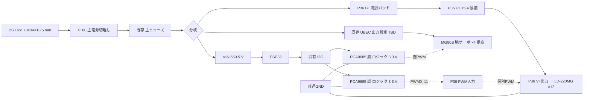

# 電源系の派生設計案 — P36 S1 / P37

このパッケージは `Ryuichi-TypeR/Tachikoma` 向けの追加レビュー案です。上流 `hapx2yuki/Tachikoma` の電源文書やファームウェアを置き換えず、既存のP21電装配置にP36脚用分配基板とP37カラー配線図を加えて評価します。

## 提案する電源構成

主ヒューズ後のB+をP36電源パッドへ入力し、基板F1後のV+出力から脚サーボへ配電します。PCA9685のサーボV+端子は使用しません。PWM0–11は各脚サーボへ独立配線し、信号基準GNDと電源帰路を区別します。電池監視と停止時の扱いは保留です。現物のスイッチ/リレー追加は行いません。既存P15は別枠の近似シミュレーションとして同梱し、その範囲を[simulator.md](simulator.md)に記載します。

| 要素 | この案での扱い |
|---|---|
| 電池 | 2S LiPo、73×34×18.5 mmの既存候補 |
| 主切離し・主保護 | XT60と既存主ヒューズを維持 |
| 脚電源 | 主ヒューズ後からP36 F1を経てLD-220MG ×12へ直接分岐 |
| P36 F1 | Littelfuse 0297015.L、15 A候補。基板の定格認定ではない |
| 腕電源 | 別分岐から既存UBECを経てMG90S ×4。割当ch0/3/4/7は提案、UBEC出力設定は不明 |
| 制御電源 | MINI560 5 VからESP32。PCA9685のロジック電源は3.3 V |
| 保留 | 電池監視、停止時の電源扱い、UBEC出力、電流・温度・ヒューズ協調 |

P36 S1の基板部品表は5品目・合計16点です。裸基板1、Keystone 3568ヒューズホルダー1、Littelfuse 0297015.Lヒューズ候補1、Samtec HTSW-103-07-L-Sヘッダー12、HTSW-107-07-L-Dヘッダー1です。ヘッダーははんだ実装候補で、圧入品ではありません。サーボ本体・既存電装品はこの基板BOMの数量に含みません。

## 上流設計との差分

上流mainの[引継ぎ資料](../../docs/HANDOFF.md)と[配線資料](../../docs/wiring.md)には、6 Vサーボ給電、腕6軸と目2軸、VBAT監視を含む旧電源方針があります。この派生案では脚LD-220MGを2S系統からP36経由で直接給電し、腕を4軸にし、電池監視は保留します。上流資料は書き換えていません。両方の方針が併記されているため、この案は採用前のレビュー対象です。

## 収録物と確認範囲

- [`hardware/power-system/p36/`](../../hardware/power-system/p36/): P36 S1のGerber/Excellon、裸基板試作ZIP、2つの基板native blend、シルク確認画像、電流スクリーニング、Gerber readback記録、PWM物理接続証拠、端子表と配線図。
- [`hardware/power-system/p37/`](../../hardware/power-system/p37/): P37カラー配線図のnative blendと画像、CSV/JSONネットリスト、保存scene確認記録、BlenderMCP用の元スクリプト。
- [電源シミュレータの範囲](simulator.md): 既存P15シミュレータの同梱範囲と検証限界。
- [`hardware/power-system/bom/`](../../hardware/power-system/bom/): P36 S1のBOM。重複するBOM object storeは含みません。
- [`hardware/power-system/MANIFEST.json`](../../hardware/power-system/MANIFEST.json): コピー元相対パスと元/梱包SHA-256の対応表。
- [`hardware/power-system/verify_package.py`](../../hardware/power-system/verify_package.py): portable manifest・ZIP・PWM/端子CSVの限定チェック。

P36の電流・温度値は元資料にあるスクリーニング計算で、実測・熱解析・定格認定ではありません。15 Aは候補ヒューズ値であり、12台の負荷適合、最大/ストール電流、ヒューズと配線の協調、端子/線材定格は未確認です。製造ZIPの整合と配線グラフ検査は製造データ/論理接続の確認に限り、発注、組立、通電、熱、実負荷、実物導通を証明しません。発注・通電許可ではありません。

P37の98ハーネスと保存scene readbackは平面図上の構成・接続グラフに関する元記録です。実配線長、線径、実物ピン配列、基板/サーボの実導通、電流容量、筐体内クリアランスは検証していません。図の色は実物線色を指定しません。`update_blender.py`と`verify_save.py`は既存P21/P36 sceneを前提とするライブBlenderMCP用資料で、単独実行可能とは扱いません。P36の生成スクリプトもこのportable checkでは実行せず、原 source artifact として収録しています。native blendは原ファイルのまま収録しています。

P37 `P37_HARNESS_NETLIST.json` の `topology_decisions` はP21由来の記録を引き継いでいます。電源方式の本提案はこのREADMEの表と配線図を読み合わせてください。P37 JSONの `approved=false`、`physical_validation=NOT_RUN`、`manufacturing_release=false` は維持され、既存source JSONの読戻し/保存結果を承認へ読み替えません。個人PCの絶対パスは、JSON・スクリプト・BOMのコピー内でsource相対表記または梱包相対パスへ置き換えました。`MANIFEST.json`にはパス置換前のsource hashを記録しています。binary blendは改変していません。

関連Issueは追跡参照のみです: [#28 EL-01](https://github.com/hapx2yuki/Tachikoma/issues/28)、[#75 EL-09](https://github.com/hapx2yuki/Tachikoma/issues/75)、[#92 RV-11](https://github.com/hapx2yuki/Tachikoma/issues/92)。このPRはIssueをクローズしません。
