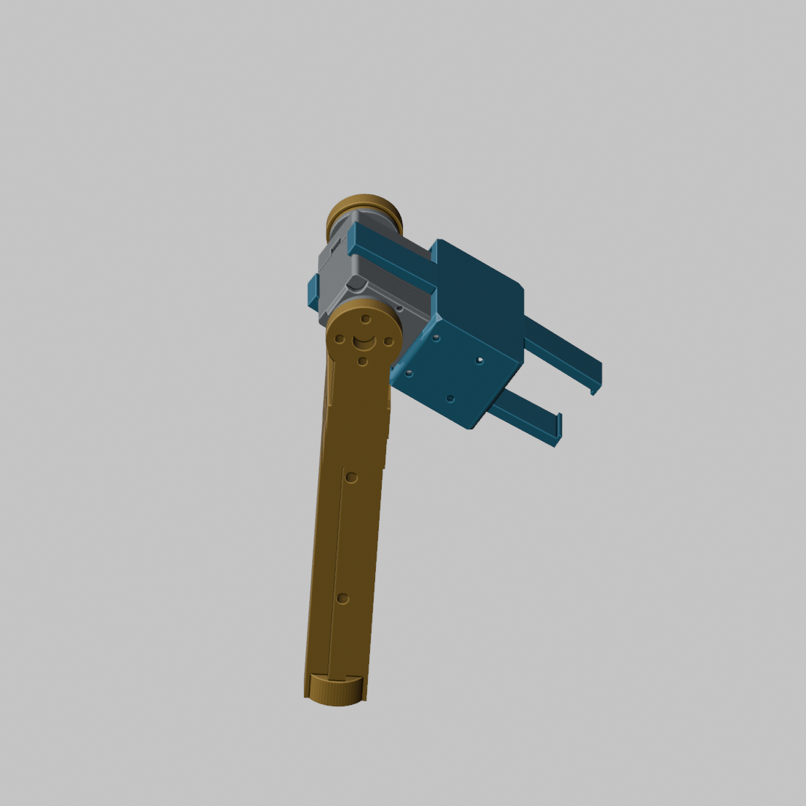

# みんなでつくるタチコマ / 脚の試作プリント

右後脚（RR）の太ももケースと脛を、各1個ずつ試しに印刷するセットです。

[図解説明書 PDF](assembly-guide.pdf) / [数量表](parts.csv)

|番号|部品|数量|STL|
|---|---|---:|---|
|A / 青|太ももケース|1|[LEG-THIGH_2_mm.stl](LEG-THIGH_2_mm.stl)|
|B / 黄|脛|1|[LEG-SHIN_1_mm.stl](LEG-SHIN_1_mm.stl)|

数字の違いはBOM内の並び順です。この2ファイルが同じ右後脚の組み合わせです。**この試作セットは縮尺100%、単位mm。既存キット向けの150%指定は適用しません。** 形状変更・追加補正なしの現行登録STLです。

青と黄が今回の印刷対象。灰色は膝サーボLD-220MGと駆動・非駆動ディスクの参照形状です。2つの印刷品だけでは固定できません。ディスクと締結ねじは別途必要で、ねじの最終規格・組立順・工具アクセスは実物確認前です。無理に押し込んだり、ねじで引き寄せたりせず、まず形状と穴の位置を確認します。

## お試しの進め方

1. A/Bを各1個。材料・機種・予定の印刷条件をコメントしてください。材料指定、期限、費用・受渡し方法は相談して決めます。
2. スライサーはmm・100%。造形方向とサポートを検討し、プレビューを保存。STLの配置は推奨造形方向を保証しません。
3. 印刷後、サポートを除去して外観を撮影。割れ・反り・穴のつぶれ・薄い縁を確認してください。
4. サーボ等があれば無通電で仮合わせ。ない場合は印刷と寸法・写真の報告だけで大丈夫です。接着・本締め・通電は今回の依頼に含みません。
5. 削る前の状態で問題箇所を写真に記録。追加加工した場合は場所と量を残してください。

## 報告テンプレート

- プリンター / 材料・メーカー：
- ノズル / 積層 / 壁数 / インフィル：
- 造形方向 / サポート / 寸法補正：
- 印刷時間 / 使用量：
- 外観・穴・サーボの収まり：
- 写真（全体・裏面・困った箇所）：
- 加工した場所・気づいたこと：

## 図と検証の範囲

実モデルをBlenderMCPで図化。色は説明用。登録メッシュ修正・STL読戻し済み、元STLとのSHA256一致を確認。スライス条件、実物嵌合、締結強度は未検証です。これは試作確認用説明書で、確定した可動脚の組立手順書ではありません。出典はCURRENT-ASSEMBLY-20261113 / CURRENT-SURFACE-MESH-REPAIR-20261113-R1。
