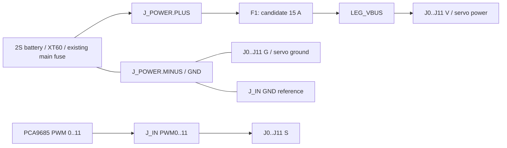

# 回路・端子割当

基板内はPOWER_IN、LEG_VBUS、GND、PWM_L0～11の15ネット。F1の4本の端子は左2本がPOWER_IN、右2本がLEG_VBUS。F1抜去時、両電源ネットは分離。部品としてのヒューズだけが両者を接続する。PCA9685のV+端子をJ_INへ接続する配線は存在しない。

## サーボ側（表面から見た座標）

中心原点、電源パッド側を+Yとする。各3ピンは中央から外側へ **S → V+ → GND**。左右で見た目の並びが逆になる。

|ch|S x|V x|G x|y (mm)|
|---|---:|---:|---:|---:|
|0|-3.81|-6.35|-8.89|-15.24|
|1|-3.81|-6.35|-8.89|-8.89|
|2|-3.81|-6.35|-8.89|-2.54|
|3|-3.81|-6.35|-8.89|3.81|
|4|-3.81|-6.35|-8.89|10.16|
|5|-3.81|-6.35|-8.89|16.51|
|6|3.81|6.35|8.89|-15.24|
|7|3.81|6.35|8.89|-8.89|
|8|3.81|6.35|8.89|-2.54|
|9|3.81|6.35|8.89|3.81|
|10|3.81|6.35|8.89|10.16|
|11|3.81|6.35|8.89|16.51|

LD-220MG公式の線色は白=PWM、赤=電源、黒=GND。実物プラグの並びは装着前に確認する。

## PWM入力側

ヘッダ本体は裏面。以下は同じ**表面基準座標**。背面から見ると左右反転するため、番号だけでなく信号名で接続する。

|y (mm)|x=-1.27|x=+1.27|
|---:|---|---|
|-7.62|PWM0|PWM6|
|-5.08|PWM1|PWM7|
|-2.54|PWM2|PWM8|
|0|PWM3|PWM9|
|2.54|PWM4|PWM10|
|5.08|PWM5|PWM11|
|7.62|GND|GND|

PCA9685とこの2×7ヘッダの間は信号割当を合わせたハーネスが必要。PCAのコネクタとそのまま機械的に一致する並びではない。GNDは共通とするが、この細い参照GNDをサーボ電源の戻り線にしない。別経路のGNDとのループ電流は実配線で確認する。

## 電源と実装

表面の+は(-3.5,25)、−は(+3.5,25)、どちらも5×8mm。各パッドの12ビアは表裏の動力銅箔を接続。裏面の電源銅箔は露出させない。

Samtec HTSW-103-07-L-Sを表面に12個、HTSW-107-07-L-Dを裏面に1個、Keystone3568を表面に1個のはんだ実装候補。サーボコネクタを含む定格は実物との組合せで検証する。サーボの3.3V PWM受信閾値もメーカー資料では未確定。
